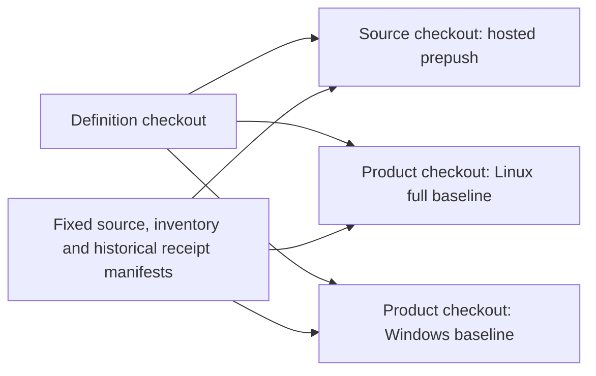

# Hosted source prepush and core baseline

This explicit mode validates product `3e5a4b02fd395c09a63bf64791b9d33e67570b26` against base `375b08bd0e1f7e8432e6514468cc9d25be01b100`. The product is published only under `backup/validation/stage2-final-core-3e5a4b02`; publication is an input handoff, not a local prepush PASS or permission to ship. Earlier ed559 receipts remain evidence for ed559 only.

Dispatch the definition branch with only `main_validation_product_sha=<exact product>`, `fault_shards=1`, `all_faults=false`, and every other selector empty. Mixed legacy-baseline or fault inputs fail before product checkout. The old baseline mode remains separate.



The three lanes run independently. Their product-specific concurrency group has `cancel-in-progress=false`; this does not promise that GitHub preserves multiple pending dispatches. Enqueue the scope once, without cancelling an existing run. No engine or fault matrix is selected.

## Exact sources and unchanged prepush

The definition is `github.sha`; the source/product is the fixed 40-character product SHA. Each checkout is verified. Product history is fetched so the exact merge base and complete change range can be checked. Tracked modifications and untracked source inputs are rejected.

The source lane prepares the product's RHWP source, Node dependencies and Rust toolchain, then executes the unchanged product script:

```sh
node tools/prepush.mjs --base 375b08bd0e1f7e8432e6514468cc9d25be01b100
```

The wrapper runs this command in the separate `source` checkout, not the driver. It retains stdout, stderr, the real status/signal/error and source identity. Any process or prepush failure prevents a success receipt. No skip option, fake executable or rewritten script is used. The step declares `CARGO_INCREMENTAL=1` after rust-cache and records its actual value; it does not change optimization, panic or overflow settings.

## Canonical objects and receipt corpus

The versioned contract is `sha256-json-stringify-utf8/v1`: SHA256 of the UTF-8 bytes of Node's `JSON.stringify(value)`, with no key sorting, trimming or pretty-printing. The actual consumer is the exported `canonicalObjectSha256` in `tools/main-diff/hosted-validation.mjs` at the exact definition commit.

The product producer is `tools/main-diff/mutation-evidence.mjs` at the fixed product commit, `createMutationEvidence(...).begin`, expression `hash(JSON.stringify(fault))`. Its pinned module hash is in the manifest. This is not an inferred helper in the live checkout of another branch.

The audit reads all three committed inputs, rather than retaining only their labels:

- `hosted-validation-manifest.json`: exact source range and fixed function/case inventory.
- `hosted-validation-reuse.json`: the frozen selection proposal, object IDs and source bindings. All 6,121 canonical objects, raw catalog hashes and 488 mutation-source files are checked against the pinned product/base Git objects.
- `hosted-validation-receipts.json`: the frozen historical receipt bodies, including the final strict original snapshot and the separate 24-target receipt/manifest. Candidate references are bound to actual completed-job IDs or the corresponding receipt body's canonical hash, product and run. The 24-target references also require the precise catalog/index and matching producer/artifact binding. An incomplete prefix is not promoted.

Binding this corpus is not acceptance of its 4,398 reuse candidates. In particular, old evidence for a function does not silently replace a changed case corpus. The current 1,723 required IDs and 185-job proposal remain conditional, undispatched data; this mode runs no mutation jobs.

## Complete baseline evidence

The unchanged baseline helper produces its inventory and comparison reports. The companion audit requires the committed fixed inventory, re-audits every raw report, and binds its identity to the same product/definition/run/attempt.

- Linux: 2,327 functions and 52,730 cases; no unlisted differences or FLOOR. The existing ledger must be reproduced by the product comparison.
- Windows: the existing four-function 29-case filter, the ten-function 64-case node-fs scope and the libuv regression command. Both comparison commands preserve failure propagation.

Artifacts retain the original reports, both plans and the companion source/inventory/corpus bindings. Baseline receipts require the hosted prepush lane in the same run. They are explicitly incompatible with the legacy product-head fault-gate contract.

Even a successful three-lane run is not fault sensitivity, acceptance of the proposed 185 jobs, release of batch1 or a change to an original MISSED, BUILD, STALE or operational failure. The separate ten-target proof requires this latest product's actual completed three-lane receipt and its own versioned retained-evidence audit before it can run.
