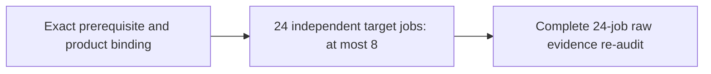

# ed559 original-21 and corrected-3 sensitivity

This definition is separate from product `ed559ed6a54c8b4c5ef0afecfe6f980d4d2b85a1`, its CI, the three-lane validation definition `8f9fd953223c552fbef04bee7b38bf78d72f282a`, and all frozen original/recovery runs. It does not resume batch1 or execute the proposed 276-job recovery plan.

## Preconditions and routing

Dispatch only this definition's explicit `mode=next-core-retained-sensitivity` and exact `product_sha`. The prepare job requires validation run `43648349140`, attempt 1, at the exact definition/ref, completed successfully with all three required jobs and their nonexpired v4 artifacts. A pending run, another head, missing lane, failed step or wrong artifact cannot open the matrix. The API snapshot is saved and its bytes are bound into every job plan; it is not relabeled as a legacy product-head fault gate. The separate validation receipt remains responsible for its original raw baseline/prepush artifact audit.

The only native jobs are the Linux target matrix. Prepare and aggregate are pure Node/data checks. The workflow uses standard hosted runners, `cancel-in-progress=false`, one matrix with max-parallel 8 and a 120-minute target timeout. It adds no automatic retries, shared checkpoints or cancellation. Existing refs keep their existing definitions.

## Original identities and producer

The manifest contains the 21 original noncontrol mutation objects and three corrected metadata objects. It retains the old/new object hashes for index-core0, provider27 and skills131, including the original failure classification. Catalog lengths, original indices, selectors, file and find text remain intact.

Each job passes the unmodified product runner a single original catalog and `FAULT_SHARD=index/N`, where `N=4*ceil(catalogLength/4)`. Thus each noncontrol target selects exactly `[0,index]`, and corrected index-core0 selects `[0]`. All 24 jobs execute 47 records including repeated positive controls. The original `index % 4` lineage is preserved; no subset catalog or renumbering is introduced.

Canonical mutation hashes use `sha256-json-stringify-utf8/v1`, implemented by `canonicalMutationObjectHash` at the exact definition. The product's `faults.mjs` and `mutation-evidence.mjs` bytes are pinned independently. They remain unchanged, including original case selection, verdict/control behavior, build profile, final normal rebuild and `finally` restoration. The opt-in append-only producer preserves every comparison's raw report before the next mutation. Evidence I/O failure is an operational failure, not sensitivity.

## Baseline and full-wire witnesses

Every target job executes its control/target selector union first, against the exact product's real registry. The manifest fixes all function/case counts and requires an empty selected ledger. Across repeated jobs this is 2,129 normal comparisons; these are not 2,129 distinct cases. `MAIN_DIFF_PROFILE=node-faults` is unchanged. Baseline, mutation and audit steps explicitly set `CARGO_INCREMENTAL=1` after rust-cache; no optimization, panic or overflow setting changes.

Each target then requires its precommitted `(fn, case)` whole-wire difference. Normal TS wires came from exact-ed559 TypeScript-only probes using the existing local WASM, not native Rust. Mutated Rust wires are independent pinned-source predictions until the hosted proof. They include errors, logs and final files, not only return values. An unexpected observed Rust value is a failure to classify, not a reason to rewrite the expected wire.

Notable boundaries:

- Provider7 observes the second callback response, not the already-resolved first code.
- Provider27 observes a scripted signature-call mismatch, not real cryptographic key acceptance.
- Provider67 predicts the unfinished JSON parser error after bypassing the completion guard, not a successful stream.
- Skills78 changes both the listed invocation mode and persisted state key.
- Skills83 replaces files, persists settings and logs trash; skills84 still fails before copying, with a different consumer reason.
- Skills131 aborts before copy/tab/handoff when the saved opener is lost.
- CLI93 changes returned link state while the adapter removes observed links before the final filesystem snapshot.
- Corrected index-core0 removes real nonempty ranges; the old invalid empty-range panic stays an old failed control.

## Strict evidence and bounded acceptance

The existing retained auditor validates exact producer identity, raw catalog and mutation hashes, actual applied source, selected command/groups, full reports/counts, independent unlisted DIFF, control verdicts, source restoration, finished record/result hashes and final normal build. STALE, FLOOR, missing/duplicate evidence, fatal diagnostics, capture errors and symbolic/extra evidence paths remain failures. The loader's optional work tree is auxiliary, excluded from the evidence artifact.

The wrapper also checks the full typed witness and rechecks selected source bytes against committed Git objects. Job/run identity stays in the producer's four-field shape; job key and manifest/plan hashes belong to the separate completion envelope. The aggregate job runs only after every matrix job succeeds, rejects missing/extra completion directories and re-audits every raw record instead of trusting a CAUGHT prefix or completion flag.

A complete result proves only these 24 follow-up targets. It does not change old MISSED, BUILD, STALE, incomplete or operational results, accept the 2,764 reuse candidates, establish full 6,121/5,748 sensitivity, release batch1 or authorize a merge/release.
